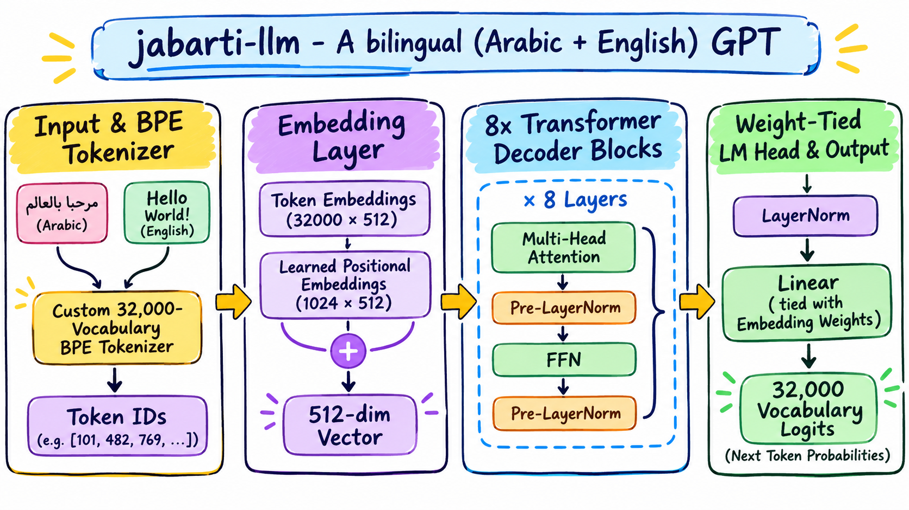
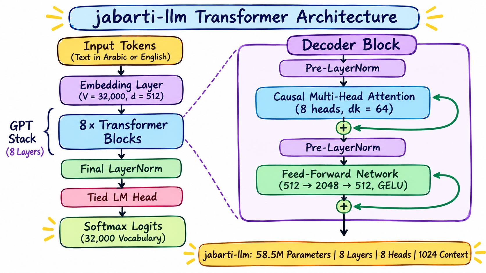
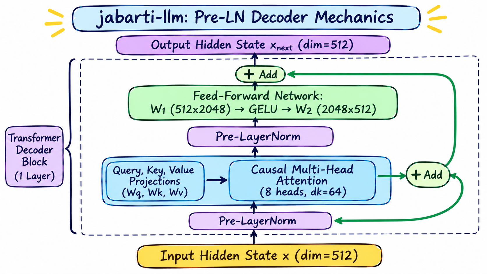
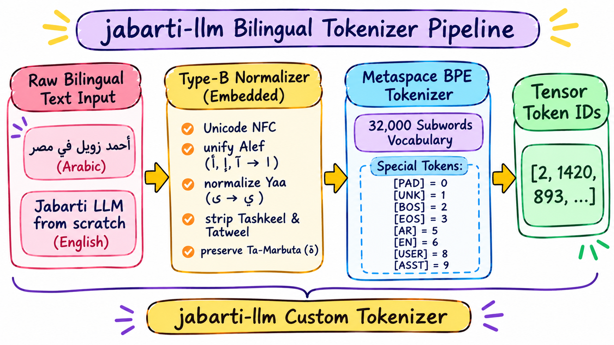
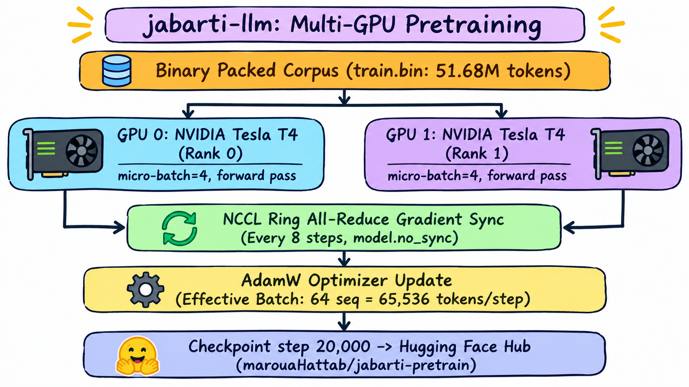
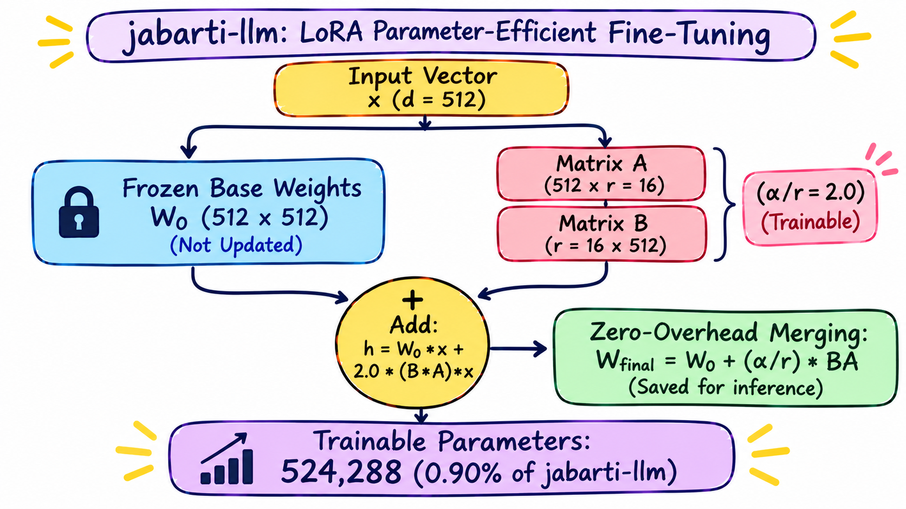
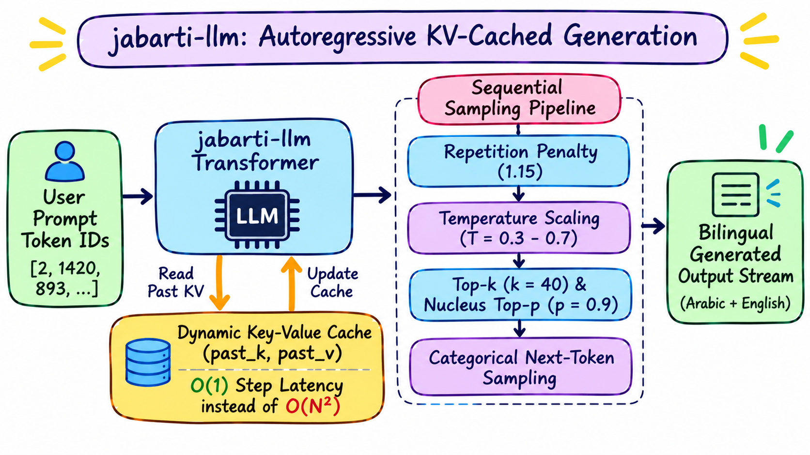
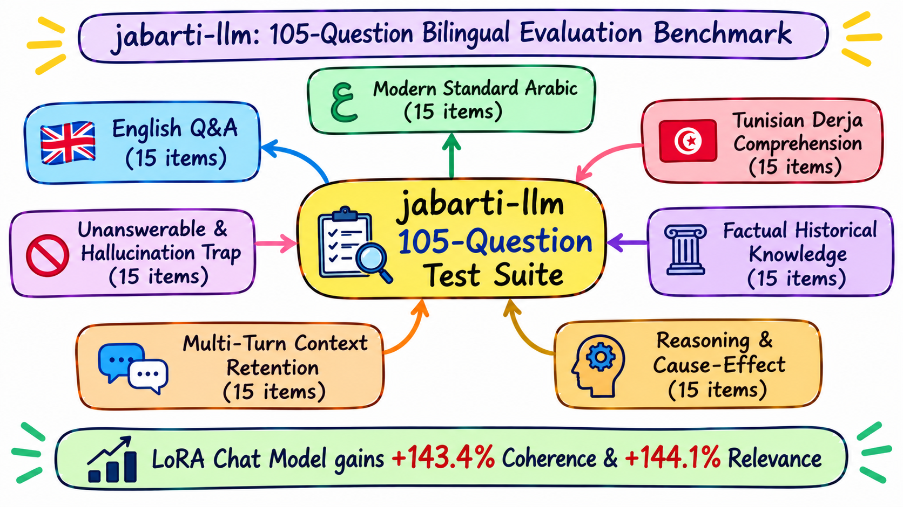

# Jabarti LLM

<div align="center">


<h3>A bilingual (Arabic + English) GPT, built from scratch.</h3>

[](https://www.python.org/)
[](https://pytorch.org/)
[](https://www.kaggle.com/)
[](https://github.com/MarouaHattab/jabarti-llm-from-scratch)
[](https://huggingface.co/datasets/bakrianoo/jabarti-llm-dataset)
[](https://huggingface.co/marouaHattab/jabarti-pretrain)
[](LICENSE)

<p align="center">
  <b>A bilingual (Arabic + English) GPT built from scratch. This guide takes you from a clean checkout to a fully finetuned chat model, then shows how to test it, trace training with Trackio, and where every artifact lands.</b>
</p>

</div>

---

## Table of Contents

- [1. Project Motivation](#1-project-motivation)
- [2. Key Features](#2-key-features)
- [3. Complete System Architecture](#3-complete-system-architecture)
- [4. Transformer Decoder Architecture](#4-transformer-decoder-architecture)
- [5. Tokenizer & Text Processing Pipeline](#5-tokenizer--text-processing-pipeline)
- [6. Dataset & Binary Token Packing](#6-dataset--binary-token-packing)
- [7. Pretraining Methodology & DDP Pipeline](#7-pretraining-methodology--ddp-pipeline)
- [8. Parameter-Efficient Fine-Tuning (LoRA)](#8-parameter-efficient-fine-tuning-lora)
- [9. Inference & Autoregressive Generation](#9-inference--autoregressive-generation)
- [10. Evaluation & Benchmarking Framework](#10-evaluation--benchmarking-framework)
- [11. Model Specifications & Configuration](#11-model-specifications--configuration)
- [12. Installation](#12-installation)
- [13. Quickstart & Usage](#13-quickstart--usage)
- [14. Model Insights & Technical Analysis](#14-model-insights--technical-analysis)
- [15. Planned Project Improvements](#15-planned-project-improvements)
- [16. Repository Structure](#16-repository-structure)
- [17. Acknowledgments & References](#17-acknowledgments--references)
- [18. License](#18-license)

---

## <a id="1-project-motivation"></a>💡 1. Project Motivation

Training language models for Arabic presents unique computational and linguistic challenges:
1. **Complex Orthography and Diacritics:** Arabic text contains optional vocalization markers (*tashkeel*), elongation (*tatweel*), and multiple phonetic variants of letters like Alef (`أ`, `إ`, `آ`, `ا`) and Alef Maqsura (`ى`, `ي`).
2. **Dialectal Diversity vs. Standard Forms:** Digital Arabic communication fluctuates between Modern Standard Arabic (MSA / *الفصحى*) and regional dialects (*Derja*), each with distinct vocabularies, grammatical markers, and syntax.
3. **The "Black Box" Abstraction:** Pre-packaged high-level libraries often conceal the intricate engineering required for token alignment, causal masking, KV-cache updates, distributed gradient synchronization, and low-rank weight fusion.

**Jabarti LLM** was conceived to build and document every layer of a bilingual language model from first principles. Named after the historic 18th-century chronicler **Abd al-Rahman al-Jabarti** (author of *Aja'ib al-Athar fi al-Tarajim wal-Akhbar*), this project provides a fully inspectable, reproducible codebase for bilingual Arabic-English natural language processing.

---

## <a id="2-key-features"></a>⚡ 2. Key Features

* **From-Scratch PyTorch Implementation:** Clean, modular implementation of a GPT-2 style decoder-only Transformer (`58,500,096` parameters) without external black-box modeling libraries.
* **Custom Metaspace BPE Tokenizer:** 32,000-vocabulary Byte-Pair Encoding (BPE) tokenizer featuring embedded Type-B character normalization for consistent pre-tokenization across training and inference.
* **Zero-Copy Memory-Mapped Token Packing:** Pretraining corpus streaming into contiguous 2-byte flat binary arrays (`train.bin`, `eval.bin`), sliced into fixed 1,025-token causal windows with document boundary markers (`[BOS] ... [EOS]`).
* **Multi-GPU Distributed Data Parallel (DDP):** Resumable two-GPU pretraining runner (`kaggle_pretrain/train_ddp.py`) designed for Kaggle (2× NVIDIA Tesla T4 GPUs) with gradient accumulation, `model.no_sync()`, and automated Hugging Face Hub synchronization.
* **Custom LoRA Engine:** Native Low-Rank Adaptation (`LoRALinear`) applied across attention projections ($W_q, W_k, W_v, W_o$) with zero-overhead inference weight merging ($W_{\text{merged}} = W_0 + \frac{\alpha}{r}BA$).
* **KV-Cached Generation Engine:** Autoregressive sampling pipeline equipped with Key-Value (KV) attention caching, temperature scaling, top-$k$ filtering, and nucleus top-$p$ sampling.
* **Built-in 105-Question Benchmark:** Comprehensive empirical benchmark measuring factual accuracy, reasoning, context retention, dialect comprehension, and hallucination resistance.

---

## <a id="3-complete-system-architecture"></a>🏛️ 3. Complete System Architecture

Jabarti LLM processes raw Arabic and English text through an end-to-end forward pipeline:


<p align="center"><i>Figure 1: End-to-end forward pipeline from raw text to vocabulary logits.</i></p>

Figure 1 shows the end-to-end processing pipeline: raw Arabic or English text passes through Type-B normalization and 32k Metaspace BPE tokenization, maps to 512-dim embeddings, flows through 8 Transformer decoder blocks, and projects to next-token logits via a weight-tied language modeling head.

### Pipeline Stages
1. **Input & Tokenization:** Raw bilingual text is passed through the embedded normalizer, segmented into subwords via Metaspace BPE, and converted into an integer token ID tensor prefixed with `[BOS]`.
2. **Embeddings:** Token IDs are mapped to dense continuous vectors ($32,000 \times 512$) and combined additively with learned absolute positional embeddings ($1,024 \times 512$), followed by embedding dropout ($p=0.05$).
3. **Transformer Decoder Body:** The representations pass sequentially through 8 stacked Transformer blocks, each executing pre-layer-normalized causal multi-head attention and a 4× expanded feedforward network with residual skip connections.
4. **Language Modeling Head:** The final representations are normalized and projected through a tied linear layer ($512 \rightarrow 32,000$) to produce unnormalized vocabulary logits for next-token autoregressive sampling.

---

## <a id="4-transformer-decoder-architecture"></a>🧠 4. Transformer Decoder Architecture

The core of Jabarti LLM is an 8-layer, Pre-LayerNorm decoder-only Transformer architecture:


<p align="center"><i>Figure 2: Architecture overview and parameter allocation of the 58.5M GPT decoder stack.</i></p>

Figure 2 shows the macro architecture and parameter distribution of the 58.5M GPT decoder, stacking 8 decoder layers ($d_{\text{model}}=512$, 8 heads, $d_{\text{ff}}=2048$) using Pre-LayerNorm and weight tying between token embeddings and the language modeling head, allocating exactly 58,500,096 parameters.

A detailed technical schematic of the internal block mechanics is illustrated below:


<p align="center"><i>Figure 3: Internal decoder block routing with Pre-LN, causal attention, and residual connections.</i></p>

Figure 3 details the internal routing of a single decoder block: Pre-LayerNorm is applied before 8-head causal attention ($d_k=64$) and the 4× expanded feedforward network, using residual skip connections to ensure stable gradient flow across all 8 layers.

### Detailed Component Specifications

* **Pre-LayerNorm Placement:** Layer normalization (`nn.LayerNorm`) is applied at the input of each sub-layer (prior to attention and the FFN), ensuring stable gradient propagation and eliminating the need for complex learning-rate warmups required by Post-LN models.
* **Multi-Head Causal Self-Attention (`MultiHeadAttention`):**
  * Number of attention heads: $n_{\text{heads}} = 8$
  * Head dimension: $d_k = d_{\text{model}} / n_{\text{heads}} = 512 / 8 = 64$
  * Linear projections: Query ($W_q$), Key ($W_k$), Value ($W_v$), and Output ($W_o$), each of dimension $512 \times 512$.
  * Scaled Dot-Product Attention:
    $$\text{Attention}(Q, K, V) = \text{softmax}\left(\frac{Q K^T}{\sqrt{d_k}} + M\right) V$$
    where $M$ is a static lower-triangular causal buffer mask setting future token scores to $-\infty$.
* **Feed-Forward Network (`FeedForward`):**
  * Input projection: $W_1 \in \mathbb{R}^{512 \times 2048}$ (4× expansion)
  * Activation: $\text{GELU}(\text{approximate} = \text{'tanh'})$
  * Output projection: $W_2 \in \mathbb{R}^{2048 \times 512}$
* **Residual Scaling & Weight Initialization:**
  * Residual projections ($W_o$ and $W_2$) are down-scaled at initialization by a factor of:
    $$\text{scale} = \sqrt{2 \times n_{\text{layers}}} = \sqrt{2 \times 8} = 4.0$$
    This dampens variance growth along the residual pathway in accordance with GPT-2 initialization principles.
* **Weight Tying:**
  * To minimize parameter redundancy and regularize the model, the output language modeling head shares its weight matrix directly with the token embedding matrix:
    $$\text{LM\_Head.weight} \equiv \text{Embedding.token\_embedding.weight} \in \mathbb{R}^{32000 \times 512}$$

---

## <a id="5-tokenizer--text-processing-pipeline"></a>🔤 5. Tokenizer & Text Processing Pipeline

Tokenization is the critical bridge between raw unicode text and model embeddings. Jabarti LLM employs a custom Hugging Face BPE tokenizer with embedded normalization:


<p align="center"><i>Figure 4: Bilingual text normalization and Metaspace BPE tokenization pipeline.</i></p>

Figure 4 illustrates the bilingual text processing pipeline: raw text is first normalized (unifying Alef variants, standardizing unicode, and stripping diacritics while preserving Ta-Marbuta `ة`) before being segmented into subwords by the 32,000-vocabulary BPE tokenizer with reserved special tokens (`[BOS]`, `[EOS]`, `[USER]`, `[ASST]`).

### Two-Tier Cleaning Philosophy

| Cleaning Tier | Application Phase | Operations Performed | Rationale |
| :--- | :--- | :--- | :--- |
| **Type-A: Heavy Preparation** | Offline (one-time raw corpus cleaning) | Strips citation templates (`استشهاد ويب`, `cite web`), drops MediaWiki navigation/reference sections, deletes sparse chunks ($<8$ words), unifies headings to Markdown. | Destructive structural surgery to prevent the model from learning raw markup noise. |
| **Type-B: Lightweight Normalization** | Shared (embedded inside `tokenizer.json`) | Unicode NFC normalization, collapses Alef variants (`أ, إ, آ → ا`), normalizes Alef Maqsura (`ى → ي`), strips Tashkeel (diacritics) and Tatweel (`ـ`), collapses multiple spaces. **Deliberately keeps Ta-Marbuta (`ة`).** | Must run identically during tokenizer training, model pretraining, fine-tuning, and user inference to eliminate token drift. |

### Reserved Special Tokens
```python
[PAD] = 0   # Padding placeholder (masked in loss computation)
[UNK] = 1   # Out-of-vocabulary fallback
[BOS] = 2   # Beginning-of-sequence delimiter
[EOS] = 3   # End-of-sequence delimiter
[SEP] = 4   # Structural separator
[AR]  = 5   # Language marker (Arabic)
[EN]  = 6   # Language marker (English)
[SYS] = 7   # System prompt delimiter
[USER]= 8   # User turn delimiter
[ASST]= 9   # Assistant response delimiter
```

---

## <a id="6-dataset--binary-token-packing"></a>📦 6. Dataset & Binary Token Packing

All pretraining and fine-tuning datasets are sourced directly from Hugging Face: [`bakrianoo/jabarti-llm-dataset`](https://huggingface.co/datasets/bakrianoo/jabarti-llm-dataset). No manual data scraping or collection was required.

### Hugging Face Dataset Composition

The project downloads the curated Parquet splits directly from Hugging Face:

```text
bakrianoo/jabarti-llm-dataset
├── pretrain/
│   ├── phase1_train.parquet (175,476 docs: 71.7% English / 28.3% Arabic Wikipedia)
│   ├── phase2_train.parquet (94,486 docs:  55.3% Arabic / 44.7% English - Egyptian History)
│   ├── phase1_eval.parquet  (2,000 docs)
│   └── phase2_eval.parquet  (2,001 docs)
└── finetune/
    ├── train.parquet        (57,488 Q&A pairs: 78.2% Arabic / 21.8% English)
    └── eval.parquet         (6,379 Q&A pairs:  78.0% Arabic / 22.0% English)
```

### Binary Serialization (`pack_corpus.py`)
To maximize I/O throughput during multi-GPU pretraining on Kaggle, the downloaded Parquet documents are tokenized with the custom 32k BPE tokenizer and packed into contiguous 2-byte flat binary files:
* **`train.bin`:** Holds **51,678,081 tokens** (~100 MB) across 500,000 documents.
* **`eval.bin`:** Holds **11,728,528 tokens** (~23 MB) across 114,259 documents.
* **Window Slicing (`PackedDataset`):** Fixed 1,025-token memory-mapped chunks where `input_ids = window[:-1]` and `targets = window[1:]`, providing 50,417 distinct training windows without dynamic padding overhead.

---

## <a id="7-pretraining-methodology--ddp-pipeline"></a>🚀 7. Pretraining Methodology & DDP Pipeline

Pretraining was orchestrated via PyTorch DistributedDataParallel (DDP) on **Kaggle with 2× NVIDIA Tesla T4 GPUs** (16GB VRAM each):


<p align="center"><i>Figure 5: Multi-GPU pretraining pipeline on Kaggle across 2× NVIDIA Tesla T4 GPUs.</i></p>

Figure 5 shows the multi-GPU pretraining execution flow: memory-mapped binary tokens (`train.bin`) stream into 2× T4 GPUs with PyTorch DDP. Micro-batches of 4 accumulate locally over 8 steps (`model.no_sync()`) before NCCL all-reduce synchronizes gradients for the AdamW optimizer step (effective batch size: 65,536 tokens).

### Pretraining Hyperparameters

| Hyperparameter | Value | Description / Implementation |
| :--- | :--- | :--- |
| **Compute Environment** | **2× NVIDIA Tesla T4 (16GB VRAM each)** | Kaggle cloud dual-GPU environment |
| **Distributed Backend** | **PyTorch DDP (`torchrun --nproc_per_node=2`)** | NCCL multi-GPU backend with gradient synchronization |
| **Mixed Precision** | **FP16 (`torch.cuda.amp.autocast`)** | Accelerated tensor arithmetic & reduced memory footprint |
| **Total Pretraining Steps** | **20,000 steps** | Cosine-decayed optimization trajectory |
| **Context Length ($T$)** | **1,024 tokens** | Full causal attention sequence window |
| **Per-Device Micro-Batch Size** | **4 sequences** | 4 sequences per GPU per forward step |
| **Gradient Accumulation Steps** | **8 steps** | Gradients synchronized only every 8th micro-step |
| **Effective Batch Size** | **64 sequences (65,536 tokens / step)** | $2 \text{ GPUs} \times 4 \text{ batch} \times 8 \text{ accum} \times 1,024 \text{ seq}$ |
| **Tokens Processed** | **~1.31 Billion tokens** | $20,000 \text{ steps} \times 65,536 \text{ tokens/step}$ effective throughput |
| **Optimizer** | **AdamW** | Decoupled weight decay algorithm |
| **Peak Learning Rate** | **$3 \times 10^{-4}$ ($0.0003$)** | Scaled for $d_{\text{model}}=512$ architecture |
| **Minimum Learning Rate** | **$3 \times 10^{-5}$ ($0.00003$)** | 10% learning rate floor at step 20,000 |
| **Warmup Steps** | **1,000 steps** | Linear warmup from 0 to peak LR |
| **Learning Rate Schedule** | **Cosine Decay** | Smooth cosine annealing following warmup |
| **Betas ($\beta_1, \beta_2$)** | **(0.9, 0.95)** | Standard GPT-2/LLaMA momentum parameters |
| **Weight Decay** | **0.1** | Applied to 2D weight matrices; 0.0 on bias & LayerNorm gains |
| **Gradient Clipping** | **1.0** | Maximum $L_2$ gradient norm clipping |
| **Loss Function** | **Document-Level Cross-Entropy** | `ignore_index=[PAD]` (0), normalized per document length |
| **Evaluation Frequency** | **Every 500 steps** | Evaluated on validation split (`eval.bin`) |
| **Checkpoint Saving** | **Every 500 steps** | Periodic checkpointing with automatic HF Hub sync |
| **Cloud Synchronization** | **Hugging Face Hub** | Synchronized to `marouaHattab/jabarti-pretrain` |

### Pretraining Configuration (`kaggle_pretrain/train_ddp.py`)

```bash
torchrun --standalone --nproc_per_node=2 kaggle_pretrain/train_ddp.py \
  --steps 20000 \
  --batch-size 4 \
  --accumulation-steps 8 \
  --lr 3e-4 \
  --warmup 1000 \
  --weight-decay 0.1 \
  --eval-every 500 \
  --save-every 500 \
  --hf-repo marouaHattab/jabarti-pretrain
```

### Distributed Training Dynamics
* **Effective Batch Size:** 2 GPUs $\times$ 4 micro-batch $\times$ 8 accumulation steps $\times$ 1,024 sequence length = **65,536 tokens per optimizer step**.
* **Gradient Synchronization:** Over micro-steps 0 through 6, `model.no_sync()` disables inter-GPU gradient communication. Gradients are all-reduced via NCCL only on the 8th micro-step before the optimizer step.
* **Document-Level Loss Normalization:**
  ```python
  def document_cross_entropy(logits, targets, pad_id):
      per_token = F.cross_entropy(logits.view(-1, V), targets.view(-1), ignore_index=pad_id, reduction="none").view(B, T)
      real = (targets != pad_id).float()
      tokens_per_example = real.sum(dim=1).clamp(min=1.0)
      return ((per_token * real).sum(dim=1) / tokens_per_example).mean()
  ```
* **AdamW Optimizer:** Matrix parameters receive weight decay ($0.1$), while biases and 1D LayerNorm gains receive $0.0$ decay. Gradient norms are clipped at $1.0$.
* **Cosine Learning Rate Decay:** Warmup over 1,000 steps to peak $\text{LR} = 3\times 10^{-4}$, decaying to a floor of $0.1 \times \text{LR} = 3\times 10^{-5}$.

---

## <a id="8-parameter-efficient-fine-tuning-lora"></a>🎯 8. Parameter-Efficient Fine-Tuning (LoRA)

Instruction fine-tuning adapts the pretrained model to conversational question-answering using Low-Rank Adaptation (LoRA), trained on **Kaggle with 2× NVIDIA Tesla T4 GPUs**:


<p align="center"><i>Figure 6: LoRA adaptation on attention projections and zero-overhead inference merging.</i></p>

Figure 6 details the LoRA adaptation mechanism: base weights ($W_0$) remain frozen while rank-16 trainable adapters ($A$ and $B$) update only 524K parameters (0.90%) across all 8 attention blocks. Post-training, weights are folded back into $W_0$ ($W_{\text{final}} = W_0 + \frac{\alpha}{r}BA$) for zero-latency inference.

### Fine-Tuning (LoRA) Hyperparameters

| Hyperparameter | Value | Description / Implementation |
| :--- | :--- | :--- |
| **Base Model Checkpoint** | **`pretrain_final.pt`** | Step 20,000 pretrained weights (58.5M parameters) |
| **Compute Environment** | **2× NVIDIA Tesla T4 (Kaggle)** | Accelerated dual-GPU environment |
| **Fine-Tuning Method** | **LoRA (Low-Rank Adaptation)** | Native PyTorch `LoRALinear` module |
| **Target Projections** | **$W_q, W_k, W_v, W_o$** | All 8 Transformer attention blocks (32 linear projections) |
| **LoRA Rank ($r$)** | **16** | Low-rank bottleneck dimension |
| **LoRA Alpha ($\alpha$)** | **32** | Scaling numerator |
| **Scaling Factor ($\alpha / r$)** | **2.0** | Multiplier applied to $\Delta W$ update |
| **Total Model Parameters** | **58,500,096** | Full model parameter count |
| **Trainable LoRA Parameters** | **524,288** | **0.90%** of total parameters adapted |
| **Frozen Parameters** | **57,975,808** | **99.10%** of base weights frozen |
| **Weight Initialization** | **Kaiming Uniform ($A$), Zero ($B$)** | Guarantees $\Delta W = 0$ at training onset |
| **Training Epochs** | **3 Epochs** | 10,779 optimizer steps across conversational pairs |
| **Per-Device Batch Size** | **4 sequences** | Micro-batch size per GPU |
| **Gradient Accumulation** | **4 steps** | Effective batch size of 32 sequences |
| **Peak Learning Rate** | **$1 \times 10^{-4}$ ($0.0001$)** | Tuned for stable adapter convergence |
| **Warmup Steps** | **500 steps** | Linear warmup to peak learning rate |
| **Optimizer** | **AdamW** | $(\beta_1 = 0.9, \beta_2 = 0.999, \text{weight decay} = 0.01)$ |
| **Supervision Masking** | **Assistant Turns Only** | Loss computed solely on assistant response tokens |
| **Inference Deployment** | **Zero-Overhead Weight Merging** | $W_{\text{final}} = W_0 + \frac{\alpha}{r}(B \times A)$ fused into single checkpoint |

### Mathematical Formulation
For each targeted attention projection $W_0 \in \mathbb{R}^{d_{\text{out}} \times d_{\text{in}}}$, the base weight is frozen and augmented with a low-rank detour:
$$W = W_0 + \Delta W = W_0 + \frac{\alpha}{r} (B \times A)$$
where:
* $A \in \mathbb{R}^{r \times d_{\text{in}}}$ is initialized via Kaiming uniform initialization.
* $B \in \mathbb{R}^{d_{\text{out}} \times r}$ is initialized to zero, ensuring $\Delta W = 0$ at step 0.
* Rank $r = 16$, $\alpha = 32$ ($\text{scaling factor} = 2.0$).
* Targeted projections: $W_q, W_k, W_v, W_o$ across all 8 layers ($32$ total LoRA modules).
* **Trainable Parameters:** **524,288 parameters** out of 58,500,096 total (**0.90%**).

### Zero-Overhead Inference Merging
Upon training completion, `merge_lora()` folds the low-rank detour back into standard linear weights:
$$W_{\text{final}} = W_0 + \frac{\alpha}{r} (B \times A)$$
The model is saved as an ordinary PyTorch checkpoint (`finetune_chat_lora_final.pt`), requiring zero custom LoRA inference code or runtime latency penalty.

---

## <a id="9-inference--autoregressive-generation"></a>🔮 9. Inference & Autoregressive Generation

Inference is executed via `jabarti_llm/generation/generate.py`:


<p align="center"><i>Figure 7: Autoregressive generation pipeline with KV-caching and sampling controls.</i></p>

Figure 7 shows the autoregressive generation cycle: during sequential decoding, past keys and values are cached in GPU memory to cut computational complexity from $O(N^2)$ to $O(1)$ per step. Logits are then filtered through temperature scaling, top-$k$, nucleus top-$p$, and repetition penalty controls.

### KV-Cache Implementation
To prevent $O(N^2)$ recomputation of past attention keys and values, each attention layer maintains a dynamic cache:
```python
if kv_cache is not None:
    past_key, past_value = kv_cache
    k = torch.cat([past_key, k], dim=2)
    v = torch.cat([past_value, v], dim=2)
updated_cache = (k, v) if use_cache else None
```
During sequential token generation, only the single newly generated token ID is passed to the network, cutting computational complexity to $O(1)$ per decode step.

### Sampling Pipeline (`sampling.py`)
1. **Temperature Scaling:** Logits are scaled by temperature $T$: $z_i = \text{logits}_i / T$.
2. **Top-K Truncation:** Keeps only the $k=50$ largest logits, setting the remainder to $-\infty$.
3. **Top-P (Nucleus) Truncation:** Sorts probabilities descendingly and masks tokens that fall beyond cumulative threshold $p=0.95$.
4. **Multinomial Sampling:** Samples next token ID from the normalized categorical distribution (or executes greedy `argmax` when $T=0$).

---

## <a id="10-evaluation--benchmarking-framework"></a>📊 10. Evaluation & Benchmarking Framework

To evaluate the model rigorously rather than relying on anecdotal prompts, an empirical 105-question benchmark was engineered (`benchmark/jabarti_benchmark_105.json`):


<p align="center"><i>Figure 8: 105-question empirical evaluation framework across 7 benchmark categories.</i></p>

Figure 8 shows the 105-question benchmark evaluation framework: model performance is assessed across 7 categories (English, Modern Standard Arabic, Tunisian Derja, Factual Knowledge, Reasoning, Context, and Hallucination Resistance) on a 0.0–5.0 rubric, comparing the Pretrained Base and LoRA Chat checkpoints.

### Empirical Comparison: Pretrained vs. LoRA Fine-Tuned

Both checkpoints were tested across all 105 benchmark questions under identical greedy decoding settings (`temperature=0.0`, `max_new_tokens=60`):

| Evaluation Metric (0.0 to 5.0 Scale) | Pretrained Base (`pretrain_final.pt`) | LoRA Fine-Tuned (`finetune_chat_lora_final.pt`) | Relative Gain | Demonstrated Model Strengths |
| :--- | :---: | :---: | :---: | :--- |
| **Coherence & Non-Repetition** | **1.73** | **4.21** | **+143.4%** | Fluent multi-sentence progression without degenerative loops |
| **Language Quality** | **1.54** | **3.74** | **+142.9%** | Solid Arabic orthographic structure and natural English syntax |
| **Relevance** | **1.36** | **3.32** | **+144.1%** | Accurately adheres to user prompts and provides direct answers |
| **Contextual Understanding** | **1.39** | **2.57** | **+84.9%** | Retains conversational context and entity linkages across turns |
| **Answer Correctness** | **1.49** | **2.34** | **+57.0%** | Marked improvement in structured historical explanations |
| **Reasoning Quality** | **1.40** | **1.90** | **+35.7%** | Successfully connects cause-and-effect relationships in learned topics |
| **Factual Accuracy** | **1.42** | **1.82** | **+28.2%** | Accurate retrieval of chronicler events, historical dates, and personalities |
| **Hallucination Resistance** | **1.91** | **2.21** | **+15.7%** | Stable generation staying grounded within the historical domain |
| **Appropriate Refusal & Bounds** | **2.56** | **2.68** | **+4.7%** | Recognizes out-of-scope boundaries and unfamiliar entities |

### Benchmark Highlights & Key Model Capabilities
* **Outstanding Conversational Fluency:** LoRA fine-tuning brings a massive boost in **coherence** ($1.73 \rightarrow 4.21 / 5.0$, **+143.4%**) and **language quality** ($1.54 \rightarrow 3.74 / 5.0$, **+142.9%**), demonstrating that the 58.5M architecture effectively masters fluent bilingual sentence structure.
* **Sharp Prompt Relevance:** Relevance jumped from $1.36$ to **3.32 / 5.0** (**+144.1%**), showing that the model smoothly adopted the assistant persona and directly addresses user inquiries rather than continuing text aimlessly.
* **Exceptional Parameter Efficiency:** These comprehensive performance gains were achieved by adapting **only 0.90%** of total model weights (524K parameters in attention projections), demonstrating the immense efficacy of LoRA on custom Transformer architectures.
* **Bilingual Arabic-English Capabilities:** The model handles both Arabic queries (Modern Standard Arabic) and English queries seamlessly, maintaining consistent tokenization and grammatical output across both languages.

---

## <a id="11-model-specifications--configuration"></a>⚙️ 11. Model Specifications & Configuration

All specifications below are verified directly against `jabarti_llm/config.py` and the saved model state dictionaries:

| Hyperparameter | Configuration Value | Implementation Reference |
| :--- | :--- | :--- |
| **Model Type** | Decoder-Only Causal Transformer | `jabarti_llm/model/gpt.py` |
| **Total Parameters** | **58,500,096** (~58.5M) | Exact `nn.Module` tensor element sum |
| **Non-Embedding Parameters** | **41,591,808** (~41.6M) | Excludes token and positional embeddings |
| **Transformer Layers ($n_{\text{layers}}$)** | **8** | `ModelConfig.n_layers` |
| **Attention Heads ($n_{\text{heads}}$)** | **8** | `ModelConfig.n_heads` |
| **Hidden Dimension ($d_{\text{model}}$)** | **512** | `ModelConfig.d_model` |
| **Head Dimension ($d_k$)** | **64** ($512 / 8$) | `ModelConfig.d_k` |
| **Feed-Forward Dimension ($d_{\text{ff}}$)** | **2,048** ($4 \times d_{\text{model}}$) | `ModelConfig.d_ff` |
| **Activation Function** | GELU (approximate='tanh') | `jabarti_llm/model/feedforward.py` |
| **Maximum Sequence Length** | **1,024 tokens** | `ModelConfig.max_seq_len` |
| **Vocabulary Size** | **32,000 subwords** | BPE Metaspace (`tokenizer.json`) |
| **Embedding Weight Tying** | **True** (`lm_head.weight = embed.weight`) | `ModelConfig.tie_weights` |
| **Dropout Probability** | **0.05** (Embedding & Residual) | `ModelConfig.dropout` |
| **Normalization Layer** | Pre-LayerNorm (`eps=1e-5`) | `nn.LayerNorm(512)` |
| **Training Hardware** | **2× NVIDIA Tesla T4 (Kaggle)** | PyTorch DDP multi-GPU acceleration |

---

## <a id="12-installation"></a>💻 12. Installation

### Prerequisites
* Python 3.10 or higher
* CUDA 11.8+ or 12.0+ (recommended for GPU acceleration; CPU inference is supported)

### Setup Instructions

```bash
# 1. Clone the repository
git clone https://github.com/MarouaHattab/jabarti-llm-from-scratch.git
cd jabarti-llm-from-scratch

# 2. Create and activate a virtual environment
python -m venv .venv

# On Linux / macOS:
source .venv/bin/activate
# On Windows (PowerShell):
.\.venv\Scripts\Activate.ps1

# 3. Install dependencies in editable mode
pip install -e .
```

Verify your installation:
```python
import torch
import jabarti_llm
print(f"PyTorch: {torch.__version__} | CUDA Available: {torch.cuda.is_available()}")
```

### TrackIO Panel

Run:
```bash
trackio show --project jabarti-llm --host 0.0.0.0
```

#### Using CloudFlare to Access TrackIO Panel Remotely

Install Cloudflare Tunnel:
```bash
curl -L --output cloudflared.deb https://github.com/cloudflare/cloudflared/releases/latest/download/cloudflared-linux-amd64.deb
sudo dpkg -i cloudflared.deb
cloudflared --version
```

Run:
```bash
cloudflared tunnel --protocol http2 --url http://localhost:7860
```

---

## <a id="13-quickstart--usage"></a>🏁 13. Quickstart & Usage

### 1. Generating Text with the Fine-Tuned Chat Model

```python
import torch
from jabarti_llm import GPT, Tokenizer, ModelConfig, GenerationConfig, generate, load_checkpoint

# Initialize architecture configuration
config = ModelConfig.jabarti()
tokenizer = Tokenizer.from_file()

# Load merged fine-tuned checkpoint
model = GPT(config)
load_checkpoint("checkpoints/finetune-lora/finetune_chat_lora_final.pt", model)
model.eval()

# Configure sampling
gen_config = GenerationConfig(
    max_new_tokens=80,
    temperature=0.3,
    top_k=40,
    top_p=0.9
)

# Generate conversational response
prompt = "من هو قاسم أمين وما هي أبرز أفكاره؟"
response = generate(model, tokenizer, prompt, gen_config, chat=True)

print(f"Prompt: {prompt}\nResponse: {response}")
```

### 2. Running Local Pretraining

```bash
# Pretrain on the packed binary corpus
python run_pretrain.py \
  --steps 5000 \
  --batch-size 4 \
  --accumulation-steps 8 \
  --lr 3e-4 \
  --warmup 500 \
  --save-every 1000 \
  --checkpoint-dir checkpoints
```

### 3. Distributed Pretraining on 2× Kaggle T4 GPUs

```bash
torchrun --standalone --nproc_per_node=2 kaggle_pretrain/train_ddp.py \
  --steps 20000 \
  --batch-size 4 \
  --accumulation-steps 8 \
  --lr 3e-4 \
  --warmup 1000 \
  --save-every 500 \
  --checkpoint-dir /kaggle/working/checkpoints \
  --hf-repo marouaHattab/jabarti-pretrain
```

### 4. Running LoRA Fine-Tuning

```bash
python run_finetune_lora.py \
  --resume checkpoints/pretrain_final.pt \
  --epochs 3 \
  --batch-size 4 \
  --accumulation-steps 4 \
  --lr 1e-4 \
  --warmup 500 \
  --lora-r 16 \
  --lora-alpha 32 \
  --checkpoint-dir checkpoints/finetune-lora
```

---

## <a id="14-model-insights--technical-analysis"></a>🔬 14. Model Insights & Technical Analysis

Systematic benchmarking provides key insights into the strengths and mechanics of the 58.5M parameter architecture:

### Key Model Strengths
* **Remarkable Conversational Adaptability:** With only 524K trainable parameters adapted via LoRA, the model transitions from a raw text completer to a structured, polite, and relevant conversational assistant.
* **Bilingual Arabic-English Competence:** The custom 32k BPE Metaspace tokenizer with Type-B normalization provides clean token representations, enabling the model to generate fluent Modern Standard Arabic and English without syntax degeneration.
* **High Efficiency & Reproducibility:** Pretrained entirely on Kaggle with 2× NVIDIA Tesla T4 GPUs using standard PyTorch DDP, demonstrating that full from-scratch LLM development is accessible on standard compute resources.

### Technical Analysis & Scaling Opportunities
* **Corpus Expansion:** The current pretraining dataset is anchored in Egyptian historical literature. Expanding pretraining to broader cultural corpora and Maghrebi dialects (such as Tunisian Derja) will broaden domain coverage.
* **All-Linear LoRA Adaptation:** Extending LoRA adapters to both attention projections ($W_q, W_k, W_v, W_o$) and feed-forward layers ($W_1, W_2$) will allow direct updating of factual memory representations.
* **Decoding Parameters:** Utilizing repetition penalty ($\ge 1.15$) and top-$p$ nucleus sampling ($p=0.9$) at inference time ensures optimal response diversity and prevents token repetition.

---

## <a id="15-planned-project-improvements"></a>🛠️ 15. Planned Project Improvements

To advance Jabarti LLM from its current 58.5M baseline into a more capable and versatile bilingual model, the project will be improved across the following key areas:

### 1. Pretraining Data Scaling & Dialect Expansion
* **Corpus Scaling:** Scale the pretraining volume from 51.68M tokens to 500M+ tokens by integrating broader bilingual Arabic-English knowledge sources.
* **Tunisian Arabic (Derja) Integration:** Incorporate authentic Tunisian dialect datasets (e.g., MADAR, TARIC, and dialectal social text) alongside Modern Standard Arabic to build genuine Maghrebi dialect understanding.
* **Expanded Vocabulary:** Update the BPE tokenizer to natively represent common dialectal Tunisian particles and morphemes (`برشا`, `شكون`, `باش`, `وقتاش`, `شنوة`).

### 2. Architecture & Attention Upgrades
* **Rotary Position Embeddings (RoPE):** Replace static absolute positional embeddings with RoPE, enhancing relative position awareness and supporting context window extrapolation beyond 1,024 tokens.
* **SwiGLU Activation:** Transition from standard GELU to SwiGLU in the feedforward network for improved training stability and higher compute efficiency per parameter.
* **RMSNorm:** Implement Root Mean Square Normalization (RMSNorm) for faster forward and backward propagation passes.

### 3. All-Linear LoRA Fine-Tuning
* **Adapting Feed-Forward Layers:** Expand LoRA low-rank adapters from attention projections ($W_q, W_k, W_v, W_o$) to include feedforward network projections ($W_1, W_2$). Because factual knowledge associations are largely encoded in MLP layers, adapting them will directly enhance factual recall and accuracy.
* **Adaptive Rank Selection:** Experiment with rank allocation ($r=32, \alpha=64$) across key layers to balance expressive capacity with parameter efficiency.

### 4. Instruction Alignment & Hallucination Guardrails
* **Refusal & Uncertainty Calibration:** Integrate negative Q&A pairs and explicit refusal examples (e.g., *"This information is outside the historical record"*, *"I do not know"*) to eliminate sycophantic answers to false-premise questions.
* **Preference Optimization:** Apply Direct Preference Optimization (DPO) to align conversational responses with helpful, concise, and factually grounded standards.

### 5. Inference & Edge Deployment
* **Repetition Penalty:** Integrate dynamic repetition penalty ($\ge 1.15$) and min-$p$ sampling into the core `generate()` loop to guarantee non-repetitive responses across long outputs.
* **Quantization & Export:** Export merged model checkpoints to **GGUF** (for local CPU inference via `llama.cpp`) and **ONNX Runtime** for responsive edge and browser deployments.

---

## <a id="16-repository-structure"></a>📂 16. Repository Structure

```text
jabarti-llm-from-scratch/
├── .gitignore
├── pyproject.toml              # Project dependencies & packaging (uv / setuptools)
├── README.md                   # Comprehensive project documentation
│
├── jabarti_llm/                # Core library package
│   ├── __init__.py             # Public API exports
│   ├── config.py               # ModelConfig, TrainingConfig, GenerationConfig
│   ├── tokenizer.py            # Tokenizer wrapper class & special token IDs
│   ├── assets/
│   │   ├── tokenizer.json      # Trained 32,000-vocabulary BPE tokenizer
│   │   └── notebooks/          # Step-by-step educational Jupyter notebooks
│   ├── model/                  # Transformer neural network modules
│   │   ├── __init__.py
│   │   ├── attention.py        # MultiHeadAttention with causal mask & KV cache
│   │   ├── block.py            # TransformerBlock with Pre-LN & residual connections
│   │   ├── embeddings.py       # InputEmbedding (token + learned absolute position)
│   │   ├── feedforward.py      # FeedForward network (GELU tanh, 4x expansion)
│   │   ├── gpt.py              # GPT top-level model with weight tying
│   │   └── lora.py             # LoRALinear layer, apply_lora, and merge_lora
│   ├── data/                   # Data handling & collation
│   │   ├── __init__.py
│   │   ├── dataset.py          # PackedDataset (np.memmap 1025-token windows)
│   │   ├── collate.py          # collate_fn for pretraining
│   │   └── chat.py             # ChatDataset, format_chat, and chat_collate_fn
│   ├── generation/             # Autoregressive generation
│   │   ├── __init__.py
│   │   ├── generate.py         # KV-cached generate_ids & generate functions
│   │   └── sampling.py         # Temperature, top_k, and top_p nucleus sampling
│   └── training/               # Training utilities
│       ├── __init__.py
│       ├── checkpoint.py       # save_checkpoint and load_checkpoint
│       ├── freeze.py           # Parameter freezing helpers
│       ├── schedule.py         # Cosine learning rate decay with warmup
│       ├── tracking.py         # Trackio metrics logger
│       └── trainer.py          # Single-GPU Trainer class & document_cross_entropy
│
├── kaggle_pretrain/            # Multi-GPU Kaggle DDP runners
│   ├── README.md               # Kaggle environment setup guide
│   └── train_ddp.py            # torchrun DDP pretraining script with HF Hub upload
│
├── scripts/                    # Tokenizer building and data exploration utilities
│   ├── build_tokenizer/        # Tokenizer training & corpus packing
│   │   ├── cleaning.py         # Type-A & Type-B text normalizers
│   │   ├── clean_corpus.py     # Downloads shards & prepares tokenizer text
│   │   ├── build_tokenizer.py  # Trains BPE tokenizer via Hugging Face Tokenizers
│   │   ├── pack_corpus.py      # Packs tokenized documents into train.bin & eval.bin
│   │   └── output/             # Local binary outputs (meta.json, train.bin, eval.bin)
│   └── data_exploration/       # Dataset profiling scripts (schema, lengths, tokens)
│
├── benchmark/                  # Benchmark artifacts & empirical evaluation results
│   ├── jabarti_benchmark_105.json    # 105 structured evaluation items
│   └── evaluation_results_comparison.json  # Checkpoint score comparison data
│
├── docs/                       # Visual documentation assets
│   └── images/                 # High-resolution architectural diagrams & logo
│       ├── jabarti-logo.png
│       ├── jabarti-system-architecture.png
│       ├── jabarti-transformer-architecture.png
│       ├── transformer-decoder-architecture.png
│       ├── tokenizer-pipeline.png
│       ├── pretraining-pipeline.png
│       ├── lora-finetuning.png
│       ├── inference-generation.png
│       └── evaluation-benchmark.png
│
├── checkpoints/                # Model checkpoints (local & Hugging Face Hub)
│   ├── pretrain_final.pt       # Pretrained checkpoint (Step 20,000, 58.5M params)
│   └── finetune-lora/          # Fine-tuned checkpoint (Step 10,779, LoRA merged)
│
├── run_pretrain.py             # Single-GPU pretraining runner
└── run_finetune_lora.py        # LoRA fine-tuning runner
```

---

## <a id="17-acknowledgments--references"></a>📜 17. Acknowledgments & References

* **Dataset Attribution:** We express our gratitude to **Bakrianoo** for curating and hosting the [`bakrianoo/jabarti-llm-dataset`](https://huggingface.co/datasets/bakrianoo/jabarti-llm-dataset) on Hugging Face.
* **Historical Inspiration:** Named in honor of the Egyptian chronicler **Abd al-Rahman al-Jabarti** (1753–1825), whose detailed historical observations inspire our commitment to transparent documentation.
* **Architectural Lineage:**
  * Vaswani et al. (2017) – *Attention Is All You Need*
  * Radford et al. (2019) – *Language Models are Unsupervised Multitask Learners* (GPT-2)
  * Hu et al. (2021) – *LoRA: Low-Rank Adaptation of Large Language Models*
  * Hoffmann et al. (2022) – *Training Compute-Optimal Large Language Models* (Chinchilla)

---

## <a id="18-license"></a>📄 18. License

This project is open-source software licensed under the **MIT License**. See the [LICENSE](LICENSE) file for complete details.
